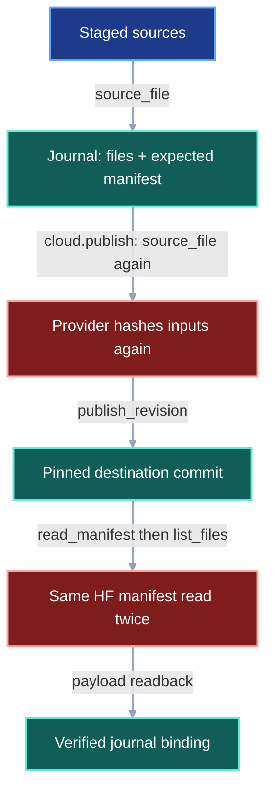
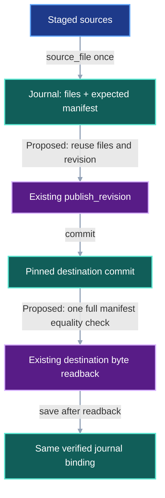
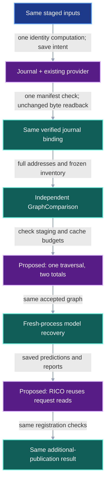

# Publication Work Reuse

## Decision and fixed scenario

Extend the existing journal, provider, space checker, and RICO checks. Preserve
all public APIs and persisted formats. The comparison uses the completed MIL /
Hopfield publication at VIPER `462b202` and RICO `cd81561d`: 783 snapshot mappings,
2,605 file addresses, 1,305 required payloads, and four recovered models.

The [completion record](../evidence/run-graph-republication-completion-20261018.json)
binds the inspected commits, passing CI, acceptance artifact, and scan observations.
An identical scientific result, full address mapping, and saved recovery output
is required before and after each optimization.

## Invariants and minimum design

| Decision | Existing owner and selected change | New or retired surface |
|---|---|---|
| Prepared identities | `PublicationJournal.publish` calls existing `provider.publish_revision` with its computed files and revision. | Retire its second VIPER hash pass and redundant returned-identity comparison; retain public `publish` for ordinary callers. |
| HF manifest | `PublicationJournal._verify` and `GraphComparison.verify` reuse their full `RevisionManifest` equality check. | Replace the following generic inventory branch with `elif`; other providers retain inventory checks. |
| Space accounting | Extend `TransferSpace.check` / `directory_bytes` to compute both totals together. | Retire the second traversal; preserve a separate inode set and confinement root for each total. |
| RICO reads | `model_checks`, `register`, and `recovery_reports` share bytes already read within one invocation. | Retire repeated request parsing and per-seed pointer hashing. |
| Verified downloads | Retain as the bounded future work below. | The active blocks preserve existing cache ownership and persisted formats. |

Reuse wins for identities, manifests, and RICO records. Extend the existing
space counter to report staging and cache totals together.
A new publication framework, trusted-hash public API, or persistent verification
index adds an authority whose invariant already has an owner. Keeping the duplicate
work remains the fallback if a candidate changes rejection behavior or fails to
show the expected operation-count reduction.

Every block preserves first-use size/SHA checks, source confinement, journal
intent before upload, exact-commit recovery, destination byte readback, full
source identities, independent graph comparison, capacity limits, and cold
acceptance with source storage blocked. File mutation between preparation and
upload must fail destination readback before the binding becomes complete.

## Current gap

The first avoidable work is the provider recomputing the identities just
computed by the journal. The original review also found the following manifest,
filesystem, and RICO repetitions. The diagrams govern the same input and result.

### Current DAG

### Proposed change DAG

### Integrated DAG

## Propagation and removal map

Paths below belong to VIPER unless prefixed with `rico:`. New tests are
**PlannedAddition**; implementation will create these observers.

| Surface | Disposition and owner |
|---|---|
| [Journal](../src/viper/execution/_promotion_journal.py), [comparison](../src/viper/execution/_promotion_compare.py) | Change in RGP-PB-09 / RGP-REQ-11. Remove duplicate hash/manifest work. |
| [Provider](../src/viper/_cloud.py), [HF provider](../src/viper/huggingface.py), [cloud service](../src/viper/cloud.py) | Retain APIs and byte validation; reuse `publish_revision`. |
| [Transfer](../src/viper/execution/_promotion_transfer.py) | Change in RGP-PB-10 / RGP-REQ-12. Replace two traversals with one. |
| [Worker](../src/viper/execution/_promotion_worker.py), [reader](../src/viper/_source.py), [verified cache](../src/viper/_verified_cache.py) | Retain in active scope; cache handoff is conditional future work. |
| `rico:tools/graph_publication/checks.py` | Change in RGP-PB-11 / RGP-REQ-13. Reuse loaded request bytes and pointer digests. |
| `rico:tools/graph_publication/recover.py` | Retain scientific inference, request binding, and report-repair behavior. |
| [Cloud tests](../tests/test_cloud_service.py) | PlannedAddition: `test_republication_reuses_prepared_identities`, `test_transfer_space_scans_both_budgets_once`. |
| [Execution tests](../tests/test_run_execution.py) | PlannedAddition: `test_republication_reads_manifest_once`. Reuse the connected graph builder and existing adversarial cases. |
| `rico:tests/test_graph_publication.py` | PlannedAddition: `test_registration_reuses_request_and_pointer_reads`; extend the existing registration fixture. |

Public types, serialized fields, journal records, manifest bytes, prediction
artifacts, and original model pointers retain their existing owners and values.

## Savings and measurement obligations

| Change | Static work reduction | Conditional time estimate | Estimated production-line delta |
|---|---|---|---|
| Prepared identities | 48,900,835,694 fewer bytes hashed by VIPER over a full new publication | 49 seconds at an assumed 1 GB/s | Approximately zero |
| Manifest reuse | 1,566 fewer manifest loads across publication and comparison | Unmeasured; cached reads may be entirely local | Zero |
| Combined scans | 5,210 fewer cache traversals for the 2,605-address comparison | About 18 minutes if the recorded 0.21-second scan cost persists | +10 to +25 |
| RICO reuse | One request read per request and one pointer digest per distinct pointer per invocation | Negligible compared with migration | -10 to +10 |
| Future cache retention | Up to one 48.9 GB destination pass when retained files fit | 8.2 minutes at an assumed 100 MB/s, plus request overhead | +40 to +100, provisional |

These projections require candidate measurements; their savings overlap. Retain operation
counts, elapsed time, input identity, production additions/deletions, and memory /
disk peaks for the tested candidate. Run fixed-input baseline and candidate
measurements in alternating order. Compare the same filesystem tree; concurrent
file changes invalidated equivalence claims in the older scan observations.
Fixed local fixtures validate these patches while preserving production transfers and saved model predictions.

## Bounded future work: verified-download retention

Inputs are the existing journal readback paths, `RunFetcher` verified paths,
full source/destination addresses, and `TransferLimits`. The proposed result is
reuse of unchanged, task-owned verified bytes between journal readback,
comparison, and ordinary verification within one execution.

This work is excluded from RGP-REQ-11 through RGP-REQ-13 and their PairBlocks.
First measure repeated network bytes, requests, hashes, and peak disk usage on
a connected fixed graph with shared content and distinct producing histories.
Promote it to the next RGP requirement only after those counts show avoidable
work, a bounded retention design beats eager deletion on the same inputs, and
corruption, alias membership, eviction, interruption, and fresh-process rejection
cases preserve the original outcomes. Cold acceptance always starts with empty
caches. Prefer extending existing cache ownership; stop if the required eviction
machinery outweighs the measured benefit. The next decision belongs to this same
contract and checklist.
