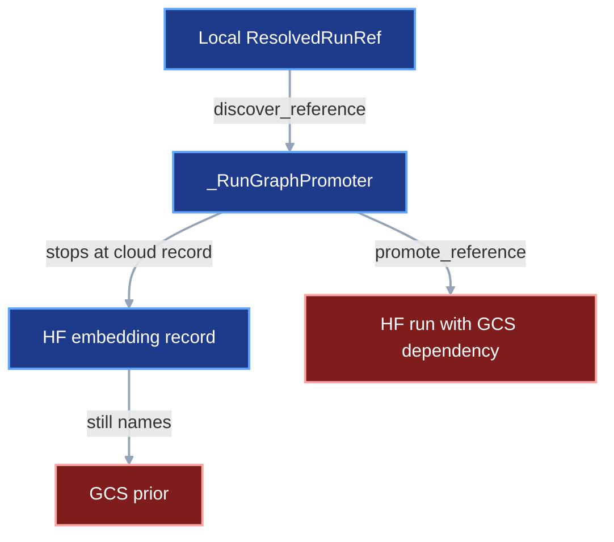
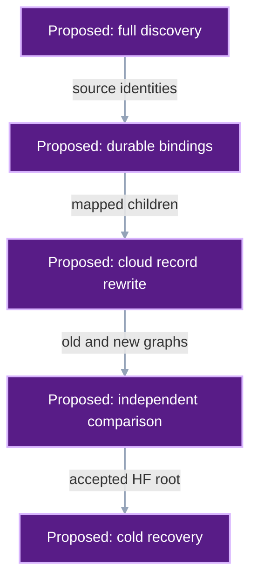
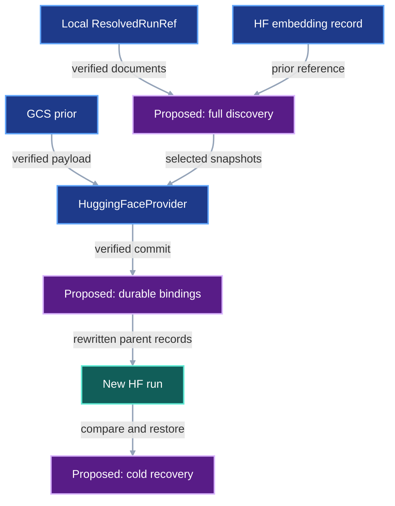

# Run Graph Republication

## 1. Status

**Contract status:** The generated region below owns current implementation status.
The [existing declaration](run-graph-republication.toml) owns requirements,
verifiers, and PairBlocks. The [checklist](../checklists/run-graph-republication.md)
orders the work. Only the first block has a frozen code candidate.

<!-- contract-protocol:generated:start -->
**In progress.** [Jump to current PairBlock](#rgp-pb-01)

**Checklist:** [Run Graph Republication](../checklists/run-graph-republication.md)

### PairBlocks

<a id="rgp-pb-01"></a>

#### <nobr><code>RGP-PB-01</code></nobr>

**Status:** review

**Requirement contribution:** Delegate document reads to the supplied verified fetcher; retain ordinary promotion and reject cloud roots.

**Review handoff**

**What changed**

- Read identified documents through the supplied RunFetcher and preserve source failures as RunPromotionError causes.
- Remove the duplicate local document reader and propagate the required fetcher through every constructor call.
- Exercise local, GCS, and Hugging Face identities, altered or missing bytes, and the unchanged public cloud-root rejection.

**Plan deviations:** The first block also tests Hugging Face document reads and unchanged cloud-root rejection; full graph relocation remains in later blocks.

**Start review:** [Open tested GitHub comparison](https://github.com/pvd232/viper/compare/77acb8382697af7fd5eb975e3afab6791505e626...a107a9f4e1832b0410d0d9e69e056d36939b10e2)

**Review these files**

- [Complete proposed diff](../plans/run-graph-republication/RGP-PB-01/patches/verified-document-reader.patch#L1)
- [Verified document reader](../src/viper/execution/_promotion.py#L99)
- [Reader and rejection tests](../tests/test_run_execution.py#L2188)

**Evidence:** [Passing gate receipt](../evidence/gates/rgp-pb-01-20261016-r3.json)

**Decision:** Approve <nobr><code>RGP-PB-01</code></nobr>, or return it with findings.

<details>
<summary>Implementation details</summary>

**Plan:** [plan.toml](../plans/run-graph-republication/RGP-PB-01/plan.toml)

**Retained patch:** [patches/verified-document-reader.patch](../plans/run-graph-republication/RGP-PB-01/patches/verified-document-reader.patch)

**Implementation roots:** [pyproject.toml](../pyproject.toml) · [pyrightconfig.json](../pyrightconfig.json) · [src/viper](../src/viper)

**Test roots:** [tests](../tests)

**Dependencies:** None

**Gate steps:**

```bash
# typecheck
(cd . && pyright --pythonpath /Users/machina/Developer/ChatGPT/viper/.venv/bin/python src/viper/execution/_promotion.py tests/test_run_execution.py)
# test
(cd . && python3 -m pytest -q -p no:cacheprovider tests/test_run_execution.py tests/test_code_style.py -k 'promotion or python_imports_are_declared_at_module_scope or repository_has_no_inline_lint_suppressions')
# documentation
(cd . && ruff check --config pyproject.toml --select D src/viper tests)
# lint
(cd . && ruff format --check --config pyproject.toml src/viper/execution/_promotion.py tests/test_run_execution.py)
# lint
(cd . && ruff check --config pyproject.toml src/viper/execution/_promotion.py tests/test_run_execution.py)
```

</details>

<a id="rgp-pb-02"></a>

#### <nobr><code>RGP-PB-02</code></nobr>

**Status:** waiting

**Requirement contribution:** Bind original sources independently of the destination and discover every required dependency before relocation.

**Plan:** None

**Current receipt:** None

**Dependencies:** <nobr><code>RGP-PB-01</code></nobr>

**Next action:** Wait for the declared dependencies.

<a id="rgp-pb-03"></a>

#### <nobr><code>RGP-PB-03</code></nobr>

**Status:** waiting

**Requirement contribution:** Republish cloud snapshots while preserving payload bytes and every mapped provenance relationship.

**Plan:** None

**Current receipt:** None

**Dependencies:** <nobr><code>RGP-PB-02</code></nobr>

**Next action:** Wait for the declared dependencies.

<a id="rgp-pb-04"></a>

#### <nobr><code>RGP-PB-04</code></nobr>

**Status:** waiting

**Requirement contribution:** Persist publication intents and verified bindings; recover uncertain commits and share ancestors across restarts.

**Plan:** None

**Current receipt:** None

**Dependencies:** <nobr><code>RGP-PB-03</code></nobr>

**Next action:** Wait for the declared dependencies.

<a id="rgp-pb-05"></a>

#### <nobr><code>RGP-PB-05</code></nobr>

**Status:** waiting

**Requirement contribution:** Enforce measured transfer budgets and reclaim only task-owned disposable files after verified publication.

**Plan:** None

**Current receipt:** None

**Dependencies:** <nobr><code>RGP-PB-04</code></nobr>

**Next action:** Wait for the declared dependencies.

<a id="rgp-pb-06"></a>

#### <nobr><code>RGP-PB-06</code></nobr>

**Status:** waiting

**Requirement contribution:** Independently compare original and rewritten graphs against the frozen inventory and exact mapping.

**Plan:** None

**Current receipt:** None

**Dependencies:** <nobr><code>RGP-PB-05</code></nobr>

**Next action:** Wait for the declared dependencies.

<a id="rgp-pb-07"></a>

#### <nobr><code>RGP-PB-07</code></nobr>

**Status:** waiting

**Requirement contribution:** Prove small-graph restart recovery and cold model loading with Mantra unavailable and bounded inference.

**Plan:** None

**Current receipt:** None

**Dependencies:** <nobr><code>RGP-PB-06</code></nobr>

**Next action:** Wait for the declared dependencies.

<a id="rgp-pb-08"></a>

#### <nobr><code>RGP-PB-08</code></nobr>

**Status:** waiting

**Requirement contribution:** Validate the real-model pilot and all selected roots before a recoverable canonical pointer cutover.

**Plan:** None

**Current receipt:** None

**Dependencies:** <nobr><code>RGP-PB-07</code></nobr>

**Next action:** Wait for the declared dependencies.


### Requirements

| Requirement | Claim | Progress | Verifiers | PairBlocks |
|---|---|---|---|---|
| <nobr><code>RGP-REQ-01</code></nobr> | The promoter must read identified protocol documents through its supplied RunFetcher.read_verified(). Local, GCS, and Hugging Face reads must enforce the recorded byte count and SHA-256. Every ordinary retrieval or verification exception must become RunPromotionError("source run graph is unavailable") with the original exception as its cause. RGP-PB-01 retains the public local-root restriction and existing publication behavior. | in_progress | <nobr><code>RGP-VR-01</code></nobr> | <nobr><code>RGP-PB-01</code></nobr> |
| <nobr><code>RGP-REQ-02</code></nobr> | An explicit optional RunPromotionPolicy must select cloud repositories to relocate, allowed external storage and Git repositories, the original GCS binding for legacy provider-neutral references, and positive resource limits. Existing three-argument calls retain local promotion semantics. Match GCS repositories by bucket and prefix and Hugging Face repositories by repository and repo_type. Source readers must use the captured original binding independently of the configured destination. Missing legacy bindings and unclassified required references must fail before publication. | planned | <nobr><code>RGP-VR-02</code></nobr> | <nobr><code>RGP-PB-02</code></nobr> |
| <nobr><code>RGP-REQ-03</code></nobr> | Discovery must traverse typed documents on every reachable supported backend before deciding which snapshots remain external. Enumerate all members of every selected sealed snapshot and reconcile them against a frozen independent inventory. Each required inventory item must map to a graph role or produce a blocking omission. Report additional snapshot members, shared ancestors, total bytes, largest snapshot, file counts, and permitted external dependencies. A retained cloud document whose child changes must itself be republished so the new root reaches the relocated child. | planned | <nobr><code>RGP-VR-03</code></nobr> | <nobr><code>RGP-PB-02</code></nobr> |
| <nobr><code>RGP-REQ-04</code></nobr> | Publication must keep every scientific payload byte-identical and rewrite only identified protocol references and the metadata identities derived from those changes. Preserve stage identities, code commits, parameters, input roles, measurements, and provenance relationships. Update run-plan stage hashes, reuse keys, source-closure links, and cloud-stage references together. Key graph mappings by complete source identity; shared payload hashes must never collapse distinct producing histories. Preserve sealed snapshot membership and reject inconsistent identities. | planned | <nobr><code>RGP-VR-04</code></nobr> | <nobr><code>RGP-PB-03</code></nobr> |
| <nobr><code>RGP-REQ-05</code></nobr> | Before remote publication, persist an intent bound to the source snapshot, destination, policy digest, expected rewritten manifest, and dependency bindings. Recover the exact verified destination commit after interruption, including a lost response after a successful commit. Publish the completed binding atomically only after verifying that commit. Reuse completed bindings across selected roots and process restarts. Serialize writers for the same publication journal; reject mismatched or corrupt state. Reconcile an uncertain remote outcome before retrying and fail closed when its identity cannot be established. Retain completed children when a parent fails. | planned | <nobr><code>RGP-VR-05</code></nobr> | <nobr><code>RGP-PB-04</code></nobr> |
| <nobr><code>RGP-REQ-06</code></nobr> | Preflight must measure selected snapshots and available staging capacity before payload verification or transfer. Path-backed payload reads, source verification, publication, and destination verification must obey explicit staging, cache, and connection limits. Count VIPER, Hugging Face, and Xet caches and cross-filesystem copies. Persist verified destination bindings before reclaiming task-owned staged files. A snapshot that cannot fit the declared budget must fail before transfer; all unmodified source bytes and shared caches remain intact. Retry and cancellation must leave recoverable evidence and bounded temporary storage. | planned | <nobr><code>RGP-VR-06</code></nobr> | <nobr><code>RGP-PB-05</code></nobr> |
| <nobr><code>RGP-REQ-07</code></nobr> | A verifier independent of the rewriting traversal must compare the source and destination graphs using the saved mapping and the frozen inventory. Require exact scientific payload hashes, exact required inventory membership, preserved non-location fields, and an explicit field-level allowlist of derived metadata changes. Every original dependency edge must reach its intended mapped destination object. Reject missing, extra, altered, or substituted required objects even when the destination graph passes ordinary verification. Record the source roots, destination roots, inventory digest, policy digest, mapping digest, and comparison result. | planned | <nobr><code>RGP-VR-07</code></nobr> | <nobr><code>RGP-PB-06</code></nobr> |
| <nobr><code>RGP-REQ-08</code></nobr> | Acceptance must run ordinary VIPER readers and model loading in a new process and fresh workspace with empty VIPER, Hugging Face, and Xet caches, no source store mounts, and retiring Mantra storage blocked. Allow only declared pinned external source repositories and the destination. Restore each selected model and run one frozen inference fixture under its recorded environment; compare against a retained expected result with a predeclared exact or numerical comparison rule. Persist inference output before downstream reporting so reporting repair reuses the measurement. Retain existing training and evaluation evidence without rerunning those experiments. | planned | <nobr><code>RGP-VR-08</code></nobr> | <nobr><code>RGP-PB-07</code></nobr> |
| <nobr><code>RGP-REQ-09</code></nobr> | Before bulk migration, a small mixed local/GCS/Hugging Face graph with two roots, a shared ancestor, distinct histories sharing payload bytes, and a reuse receipt must pass discovery, publication, restart recovery, independent comparison, and cold model recovery. Interrupt after a remotely committed child before its local acknowledgement and verify restart reuses that exact child. Record actual memory, disk, and connection observations. Preserve ordinary promotion tests and reject early public cloud-root enablement until the complete path passes. | planned | <nobr><code>RGP-VR-09</code></nobr> | <nobr><code>RGP-PB-07</code></nobr> |
| <nobr><code>RGP-REQ-10</code></nobr> | Migrate one selected real model first, then every remaining frozen MIL and Hopfield root using shared verified mappings. Acceptance evidence must bind each exact source and destination root, payload inventory, source-code and runtime identities, cold recovery result, and inference fixture. Advance canonical SOTA pointers as one recoverable, compare-and-swap update only after every selected root passes; reject stale pointer generations or any missing acceptance. Retain old pointers and GCS objects for rollback. Configure subsequent publication after the accepted cutover. Record the application-owned pointer paths and execution bindings before freezing this block; library code must not guess them. | planned | <nobr><code>RGP-VR-10</code></nobr> | <nobr><code>RGP-PB-08</code></nobr> |

### Verification rules

| Rule | Requirements | Acceptance conditions | Success case | Rejection cases |
|---|---|---|---|---|
| <nobr><code>RGP-VR-01</code></nobr> | <nobr><code>RGP-REQ-01</code></nobr> | The injected fetcher reads each supported backend and returns the exact bytes.<br>Missing bytes, different size, and different SHA-256 are rejected with the exact public message and preserved cause.<br>The reader refactor still rejects cloud roots before retrieval or publication. | [test_promotion_document_reader_uses_verified_source](../tests/test_run_execution.py) | [test_promotion_document_reader_rejects_invalid_source](../tests/test_run_execution.py)<br>[test_promotion_document_reader_keeps_cloud_roots_rejected](../tests/test_run_execution.py) |
| <nobr><code>RGP-VR-02</code></nobr> | <nobr><code>RGP-REQ-02</code></nobr> | The same source graph resolves after the destination is changed to Hugging Face.<br>RunPromotionError contains "legacy source binding is required" for an unbound provider-neutral source.<br>RunPromotionError contains "unclassified graph dependency" for required storage outside the explicit policy; no publication occurs. | [test_promotion_policy_preserves_source_binding](../tests/test_run_execution.py) | [test_promotion_policy_rejects_unbound_legacy_source](../tests/test_run_execution.py)<br>[test_promotion_policy_rejects_unclassified_dependency](../tests/test_run_execution.py) |
| <nobr><code>RGP-VR-03</code></nobr> | <nobr><code>RGP-REQ-03</code></nobr> | A Hugging Face parent pointing to a retiring GCS prior is traversed and rewritten.<br>RunPromotionError contains "inventory item is unreachable" when a required inventory entry has no graph binding.<br>RunPromotionError contains "storage cycle" for cyclic snapshot dependencies. | [test_promotion_discovers_mixed_cloud_ancestors](../tests/test_run_execution.py) | [test_promotion_rejects_inventory_omission](../tests/test_run_execution.py)<br>[test_promotion_rejects_storage_cycle](../tests/test_run_execution.py) |
| <nobr><code>RGP-VR-04</code></nobr> | <nobr><code>RGP-REQ-04</code></nobr> | Two producers with identical payloads retain distinct mapped records and consumer edges.<br>RunPromotionError contains "conflicting source identity" for two identities asserted for the same source object.<br>An independently valid substitute ancestor is rejected with "graph relationship changed". | [test_republication_preserves_shared_payload_histories](../tests/test_run_execution.py) | [test_republication_rejects_conflicting_source_identity](../tests/test_run_execution.py)<br>[test_republication_rejects_wrong_valid_ancestor](../tests/test_run_execution.py) |
| <nobr><code>RGP-VR-05</code></nobr> | <nobr><code>RGP-REQ-05</code></nobr> | Inject interruption before and after every persistent write and remote commit boundary; recovered references equal the uninterrupted binding.<br>A second selected root uses the already-verified shared ancestor binding.<br>RunPromotionError contains "publication journal differs", "remote publication outcome is unresolved", or "publication journal is locked" for the corresponding rejection. | [test_republication_recovers_commit_after_lost_response](../tests/test_cloud_service.py) | [test_republication_rejects_journal_drift](../tests/test_cloud_service.py)<br>[test_republication_rejects_ambiguous_remote_outcome](../tests/test_cloud_service.py)<br>[test_republication_rejects_concurrent_writer](../tests/test_cloud_service.py) |
| <nobr><code>RGP-VR-06</code></nobr> | <nobr><code>RGP-REQ-06</code></nobr> | Measured peak staging bytes, cache bytes, and concurrent connections stay within the supplied policy.<br>RunPromotionError contains "staging budget is insufficient" before a payload download when the snapshot cannot fit.<br>Injected transfer failure releases only task-owned disposable files and retains the journal and verified destination bindings. | [test_republication_obeys_resource_limits](../tests/test_run_execution.py) | [test_republication_rejects_insufficient_staging](../tests/test_run_execution.py)<br>[test_republication_bounds_cleanup_after_failure](../tests/test_run_execution.py) |
| <nobr><code>RGP-VR-07</code></nobr> | <nobr><code>RGP-REQ-07</code></nobr> | Comparison accepts only location changes and their declared derived identities.<br>RunPromotionError contains "graph relationship changed" for the wrong valid ancestor.<br>RunPromotionError contains "unexpected metadata change" for altered parameters, code identity, roles, or measurements. | [test_republication_compares_source_and_destination](../tests/test_run_execution.py) | [test_republication_comparison_rejects_valid_substitution](../tests/test_run_execution.py)<br>[test_republication_comparison_rejects_extra_metadata_change](../tests/test_run_execution.py) |
| <nobr><code>RGP-VR-08</code></nobr> | <nobr><code>RGP-REQ-08</code></nobr> | A fresh process restores the model and produces the expected bounded inference result using only permitted endpoints.<br>A deliberately retained Mantra dependency causes an observed blocked read and failed acceptance.<br>A changed output fails the fixture comparison; rerunning a report reuses the immutable inference output. | [test_republication_cold_recovery_runs_fixture](../tests/test_run_execution.py) | [test_republication_cold_recovery_rejects_source_fallback](../tests/test_run_execution.py)<br>[test_republication_cold_recovery_rejects_fixture_mismatch](../tests/test_run_execution.py) |
| <nobr><code>RGP-VR-09</code></nobr> | <nobr><code>RGP-REQ-09</code></nobr> | One retained rehearsal receipt binds all stages and measured resource peaks.<br>A missing prior or donor dependency fails before any canonical pointer is updated. | [test_republication_rehearsal_recovers_shared_graph](../tests/test_run_execution.py) | [test_republication_rehearsal_rejects_incomplete_graph](../tests/test_run_execution.py) |
| <nobr><code>RGP-VR-10</code></nobr> | <nobr><code>RGP-REQ-10</code></nobr> | A retained real-model pilot precedes the full selected-root acceptance set.<br>RunPromotionError contains "canonical pointers changed" for a stale compare-and-swap input.<br>RunPromotionError contains "migration acceptance is incomplete" until every selected root passes; interrupted pointer publication recovers all-old or all-new authoritative state. | [test_republication_cutover_requires_all_acceptances](../tests/test_run_execution.py) | [test_republication_cutover_rejects_stale_pointers](../tests/test_run_execution.py)<br>[test_republication_cutover_rejects_partial_acceptance](../tests/test_run_execution.py) |
<!-- contract-protocol:generated:end -->

## 2. Claim

VIPER will republish the selected MIL and Hopfield run graphs into Hugging Face,
preserve their scientific payloads and provenance relationships, and demonstrate
recovery with Mantra storage unavailable before canonical SOTA pointers change.

The saved run references are the starting inputs. The scope includes model
weights, priors, derived builds, embeddings, prepared inputs, teachers, donor
memories, and retained inference and evaluation evidence required by those roots.
Each required item must appear in a frozen inventory and have a graph binding.
The inventory checks graph completeness; typed references determine traversal.

Weights and other scientific payloads retain their exact bytes. Records that
name relocated files receive new references and new hashes. Parent identities
change accordingly. Source run IDs, stage IDs, source-code commits, parameters,
input roles, and the meanings of measurements remain unchanged. Historical
references continue to identify the original objects.

This work extends [the promoter](../src/viper/execution/_promotion.py),
[RunFetcher](../src/viper/_source.py), and the existing
[Hugging Face provider](../src/viper/huggingface.py). It keeps the native manifests
and readers. [export_run()](../src/viper/execution/_export.py) remains an archival
operation; its bundle-specific bindings and retained in-memory payloads make it
unnecessary as an intermediate transfer step.

## Current gap

At baseline `77acb8382697af7fd5eb975e3afab6791505e626`, public promotion accepts
local roots, discovery skips cloud documents, and cloud references pass through
unchanged. Mapping tables are process-local. The following diagrams hold one
scenario fixed: a local training run references a Hugging Face embedding record
whose required prior remains in retiring GCS storage.

### Current path



### Proposed changes



### Integrated path



The first missing connector is discovery through the cloud embedding record.
RGP-PB-02 owns discovery and source selection, RGP-PB-03 owns cloud rewriting,
RGP-PB-04 owns durable bindings, RGP-PB-06 owns comparison, and RGP-PB-07 owns
cold recovery. RGP-PB-01 supplies the shared verified document reader first.

## 3. Models

The operator freezes source roots and an inventory before publication. The
promoter records what each source snapshot became. An independent verifier
consumes both graphs, that mapping, and the inventory before accepting a root.

| Model | Role and owner |
|---|---|
| `ResolvedRunRef`, `ResolvedFileRef`, `ResolvedStageRef`, `StageResultSnapshot` | Existing [references](../src/viper/references.py) retain provider-specific identities. Use their full serialized identities for graph bindings. |
| `RunPromotionPolicy` | Proposed public model in [storage](../src/viper/storage.py); supplies relocation selectors, external allowances, legacy binding, and resource limits. |
| `RevisionManifest` | Existing [_cloud model](../src/viper/_cloud.py) seals snapshot membership, payload identities, owner, and workspace. Preserve its serialized format. |
| `PromotionInventory` | Proposed private persisted model in the promotion implementation; records frozen roots and independently enumerated required files before transfer. |
| `PromotionJournal` | Proposed private persisted model; owns publication intents, verified mappings, and recovery state for one policy and destination. |
| `PromotionAcceptance` | Proposed private persisted model; binds graph comparison and cold recovery to exact roots and immutable evidence. |

The optional keyword `policy: RunPromotionPolicy | None = None` extends
`promote_run_to_cloud(repository_root, source, destination)`. `None` retains
ordinary local promotion. The first block leaves the public signature unchanged.
Migration policy enables cloud roots only after the complete rehearsal passes.
Update the public API reference and examples with the policy implementation.

The policy's proposed fields are:

| Field | Type | Producer and consumer |
|---|---|---|
| `relocate_repositories` | `tuple[ViperCloudRepository, ...]` | Operator selects retiring repositories; discovery classifies references. |
| `allowed_external_repositories` | `tuple[ViperCloudRepository, ...]` | Operator names retained storage; the comparison verifier checks every remaining external edge. |
| `allowed_git_repositories` | `tuple[HttpUrl, ...]` | Operator supplies pinned source-repository allowances; cold recovery checks repository URLs and recorded commits. |
| `legacy_source_repository` | `GcsRepository \| None` | Operator captures the original binding; the source fetcher resolves provider-neutral references independently of the destination. |
| `max_staging_bytes` | `PositiveInt` | Operator supplies the measured staging budget; preflight and transfer enforce it. |
| `max_cache_bytes` | `PositiveInt` | Operator supplies the aggregate task-cache budget; all participating readers enforce it. |
| `max_connections` | `PositiveInt` | Operator supplies the connection ceiling; transfer scheduling and provider configuration enforce the same ceiling. |

Repository selectors must be disjoint. Local references always move. GCS
selectors match both bucket and prefix; Hugging Face selectors match repository
and repository type. A preserved parent's changed child forces republication of
the parent and its ancestors. Discovery continues through allowed external locations. Historical URL strings
in logs remain evidence; loaders that consume such a value must expose that dependency
in the inventory or fail the recovery test.

The private persisted records add these facts, using existing reference types:

| Record | Required fields and types |
|---|---|
| `PromotionInventory` | `schema_version: Literal[1]`; `roots: tuple[ResolvedRunRef, ...]`; `required_files: dict[str, ResolvedFileRef]`, keyed by unique application role. |
| `PromotionJournal` | `schema_version: Literal[1]`; `inventory_sha256: SHA256`; `policy_sha256: SHA256`; `destination_repository: ViperCloudRepository`; `destination: ViperCloudDestination`; `entries: tuple[PromotionSnapshotEntry, ...]`. |
| `PromotionSnapshotEntry` | `source: StageResultSnapshot`; `source_files: tuple[SnapshotFileRef, ...]`; `destination_manifest: RevisionManifest`; `dependency_bindings_sha256: SHA256`; `published: CloudStageResultSnapshotRef \| None`. A missing `published` value denotes an intent requiring reconciliation; source membership uses the existing snapshot file identities on every backend. |
| `PromotionAcceptance` | `schema_version: Literal[1]`; `source_roots: tuple[ResolvedRunRef, ...]`; `destination_roots: tuple[ResolvedRunRef, ...]`; `inventory_sha256: SHA256`; `policy_sha256: SHA256`; `mapping_sha256: SHA256`; `comparison_evidence: ResolvedFileRef`; `recovery_evidence: ResolvedFileRef`; `inference_output: ResolvedFileRef`. |

Before RGP-PB-04 freezes, select the existing canonical serialization and atomic
persistence functions that can carry these records; document their exact owners.
Keep new state private until a demonstrated caller needs a
public interface. The existing provenance format and transfer owners carry this extension.

## 4. Execution

1. Freeze the selected source roots, independent inventory, original legacy
   binding, destination repository, relocation policy, and pinned source code.
2. Discover all typed documents and selected snapshot members. Reconcile the
   inventory and report additional files, total bytes, largest snapshot, file
   counts, and external dependencies. Reject omissions before publication.
3. Measure free disk and provider constraints. Set explicit resource budgets
   before source payload verification populates caches. An oversized snapshot
   requires a larger staging host or an explicitly reviewed publication change.
4. Verify source bytes through `RunFetcher`; use `read_verified()` for small
   documents and `read_verified_path()` for payloads. Reuse provider clients.
5. Publish dependencies before parents. Persist each publication intent, publish
   through `ViperCloud.publish()`, verify the exact returned commit and manifest,
   then persist the completed mapping before reclaiming staged bytes.
6. Rewrite referring records, run-plan member hashes, reuse keys, and source
   closure receipt identities. Reuse graph mappings across the selected roots
   while preserving different producer histories that happen to share bytes.
7. Run ordinary verification and the independent source/destination comparison.
8. Perform cold recovery and one bounded inference fixture. Persist the output
   before evaluating or reporting it; reporting repairs reuse that exact output.
9. Accept a real-model pilot, then all selected roots. Update the application’s
   canonical pointers through one recoverable compare-and-swap operation. Keep
   original objects and pointers available for rollback.

The publication chain remains `_RunGraphPromoter._publish_sources()` to
`ViperCloud.publish()` to `HuggingFaceProvider.publish_revision()` to
`HfApi.create_commit()`. Exact commit references remain mandatory. A convenience
upload that splits a snapshot across commits must still seal one complete final
manifest before its reference is returned.

An interrupted remote commit is an unknown outcome until reconciliation proves
its identity. Inspect candidate commits and match the exact manifest, owner,
workspace, and expected rewritten content. Reuse a verified completed commit.
An unresolved outcome requires a retained intent and an explicit failure before
any competing parent graph can be published.

## 5. Persisted evidence

| Artifact | Writer, reader, and acceptance purpose |
|---|---|
| Frozen inventory and policy | Operator supplies them; preflight validates identities and computes canonical digests. These bytes remain unchanged for one migration. |
| `.viper/promotion/<operation-digest>/journal.json` | Proposed promotion writer atomically replaces this authoritative record under an exclusive lock. The operation digest binds inventory, policy, destination repository, and destination. Restart reloads and validates every completed binding. |
| Verified destination commits | Existing provider writes them; independent readers verify manifest membership and every required payload. Completed children survive parent failures. |
| Resource observations | Transfer records peak staging bytes, aggregate cache bytes, connections, file counts, and failures. Acceptance compares these observations with the frozen limits. |
| Graph comparison and cold recovery outputs | Independent checks retain exact inputs, allowed transformations, blocked endpoints, cache roots, environment identity, fixture comparison, and result. |
| Application pointer transition | Application owner retains the old generation, complete old/new root mapping, all acceptance references, recovery intent, and final commit record. The final record determines which generation is authoritative. |

Derive output paths from one operation identity; use existing canonical encoding,
hashing, and atomic-write primitives. Task-owned staging files are disposable
only after their destination binding verifies. Shared caches, original stores,
and completed measurement artifacts are retained. All scientific-result evidence
remains valid independently of later formatting or reporting failures.

## 6. Verification

The generated verifier table names each success and rejection observer. Those
tests are proposed until the corresponding block is materialized and checked.
Only RGP-PB-01 currently supplies executable changes.

Comparison must enumerate required roles independently of the rewrite walk. It
checks the exact old-to-new edge mapping and permits only relocated references,
document byte counts and hashes, snapshot identities, run-plan member hashes,
reuse stage hashes, and source-closure identifiers derived from those changes.
A different ancestor is a rejection even when its own records verify. Key order in JSON mappings is
nonsemantic; named values and required key sets decide equality.

Cold recovery uses a new process, fresh workspace, empty VIPER/Hub/Xet caches,
original mounts excluded, and an enforced block on retiring storage. Merely removing
credentials is insufficient when anonymous access or another cache can satisfy
a read. Inspect the model's normal restore and load path for hidden filesystem
dependencies. A local read outside the declared fresh workspace or pinned code
must be explained and explicitly permitted or rejected.

Freeze the fixture inputs, expected output, comparator, numerical tolerance,
source commit, and environment before the pilot. Model training and full
benchmark reruns remain outside this migration. Persist the bounded inference
measurement once and reuse it when only its verifier or report changes.

## 7. Propagation

| Surface | Required change |
|---|---|
| `_RunGraphPromoter.read_local()` | Replace with `read_document()` in RGP-PB-01; remove its duplicate byte/hash validation and update all constructor callers. |
| `RunFetcher` and `_cloud_service()` | Retain verified reading and provider client reuse; extend original legacy binding and bounded cache ownership in RGP-PB-02/05. |
| `snapshot_for()`, `discover_*()`, local snapshot map types | Generalize to provider-specific snapshots in RGP-PB-02; retain one discovery implementation. |
| `promote_reference()`, `promote_snapshot()`, `promote_stage_reference()` | Replace unconditional cloud pass-through with policy decisions and cloud snapshot publication in RGP-PB-03. |
| `rewrite_typed()`, `_rewrite_reuse_receipt()`, `_rewrite_source_closure()` | Retain their responsibilities; remove local-only early returns only when cloud equivalents and observing tests exist. |
| `discover_plan_document()`, `_source_repository()` | Their direct local reads remain necessary in RGP-PB-01; consolidate source handling in RGP-PB-02 using manifest identities established before retrieval. |
| `_contains_local_reference()` | Retain ordinary promotion rejection. RGP-PB-06 adds the explicit policy and independent complete-graph check for migration. |
| `HuggingFaceProvider.publish_revision()` | Retain native manifests and exact commits; extend uncertain-outcome recovery in RGP-PB-04 and connection/budget enforcement in RGP-PB-05. |
| `hashlib`, `_publish_sources()`, `source_identity()` | Retain: snapshot identity, path confinement, and final-reference verification still use them. Remove code when its last caller disappears in a later block. |
| `export_run()` and bundle readers | Retain unchanged as the separate archival interface. |
| [API reference](../docs/reference/api.md), [cloud guide](../docs/how-to/cloud-storage.md), [protocol](../docs/reference/protocol.md) | Update alongside the public policy and cloud-root acceptance changes; preserve default three-argument examples. |
| [Promotion tests](../tests/test_run_execution.py), [provider tests](../tests/test_cloud_service.py), [storage tests](../tests/test_storage.py) | Add success and rejection cases at the owning boundary, including fault injection and measured resource limits. |
| Application-owned SOTA pointer files | Exact paths and runtime are required inputs to RGP-PB-08; they remain pending external bindings. |

Each future block must record its new files and symbols as planned additions,
and include an exact removal map for replaced helpers, branches, tests, imports,
and documentation. A new abstraction must own a distinct invariant or retire
existing machinery. Keep public imports in their documented domain modules;
the package initializer remains docstring-only.

## 8. Acceptance case

### Success

Two selected roots share a prior, while two other stages have different producing runs and share identical
payload bytes. One embedding record is already on
Hugging Face and names a required prior in retiring GCS. Discovery accounts for
every inventory role and the containing snapshots. The prior is copied unchanged,
the embedding record is rewritten, and both parents receive the verified mapping.
An interruption after the prior's remote commit loses the local acknowledgement.
Restart recovers that commit and completes both roots. Independent comparison
preserves both distinct producer histories. Cold recovery restores both models
and matches their frozen inference fixtures with Mantra blocked.

### Rejection

Replace the migrated embedding's prior reference with another valid prior that
has valid storage and hashes. Ordinary destination verification may accept that
graph. The independent comparison rejects it because the consumer edge differs from
the original inventory role and saved source-to-destination mapping.
Canonical pointers stay at their original generation.

## 9. Implementation order

The package declares eight dependent PairBlocks, and the checklist places every
requirement exactly once. Each block includes its implementation, observing
tests, documentation, removal review, and a task-scoped reviewed commit.

Start with the [RGP-PB-01 plan](../plans/run-graph-republication/RGP-PB-01/plan.toml).
Then implement source binding and discovery, cloud rewriting, durable recovery,
resource controls, independent comparison, and the small complete rehearsal.
Only after those checks pass should a real-model pilot begin. The final block
requires the exact model roots, inventory, runtime, destination, pointer paths,
and publication authorization for that operational run.

## 10. Master checklist

The [typed workspace](../checklists/run-graph-republication.toml) owns phase
placement and executable bindings. The [generated checklist](../checklists/run-graph-republication.md)
owns the human resume point. Freeze each future candidate and its baseline after its predecessor is accepted.

## 11. Contract-owned PairBlocks

The generated region presents the authoritative dependency and requirement map.
The [first handoff](../plans/run-graph-republication/RGP-PB-01/README.md) explains
the complete reader slice and its internal review. Proposed code lives only in
the [retained patch](../plans/run-graph-republication/RGP-PB-01/patches/verified-document-reader.patch).
Later patches are authored from the then-current implementation.

## 12. ContractTarget

The shared contract protocol materializes the first plan over its exact Git
baseline, applies only the declared file actions, and verifies the candidate
manifest. The current patch owns the promoter and its existing test module.
Generated Markdown owns status; authored prose owns explanation. Preparing this plan changes only its declarations, documentation, candidate
payloads, and review evidence.

## Sources

- [Hugging Face repository guidance](https://huggingface.co/docs/hub/storage-limits#explanations)
  documents operation-count constraints and commits that can complete after a
  client timeout. Check current quotas and snapshot sizes before the real run.
- [Hugging Face upload documentation](https://huggingface.co/docs/huggingface_hub/guides/upload)
  distinguishes high-level resumable upload behavior from commit-level operations.
  Preserve VIPER's final manifest and exact commit semantics when adapting transfers.
